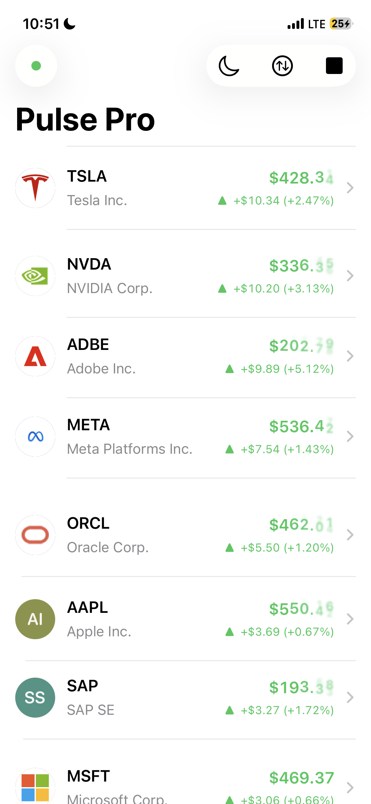
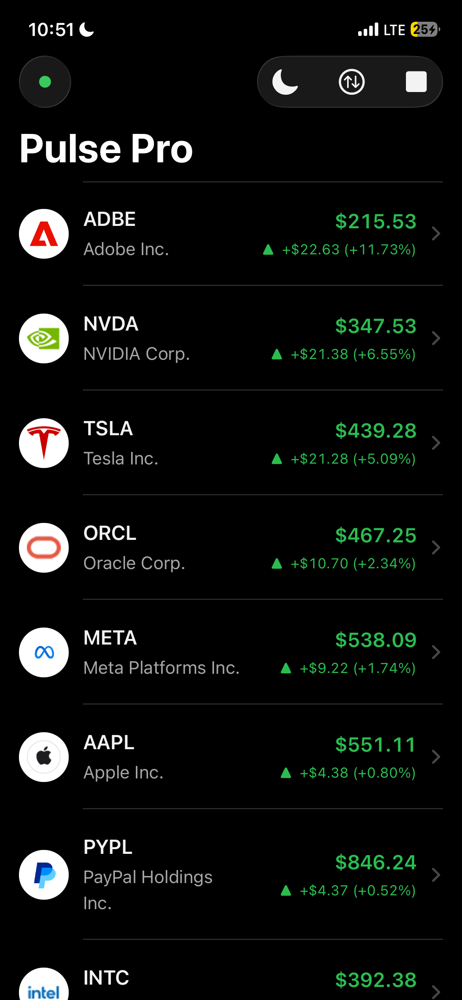
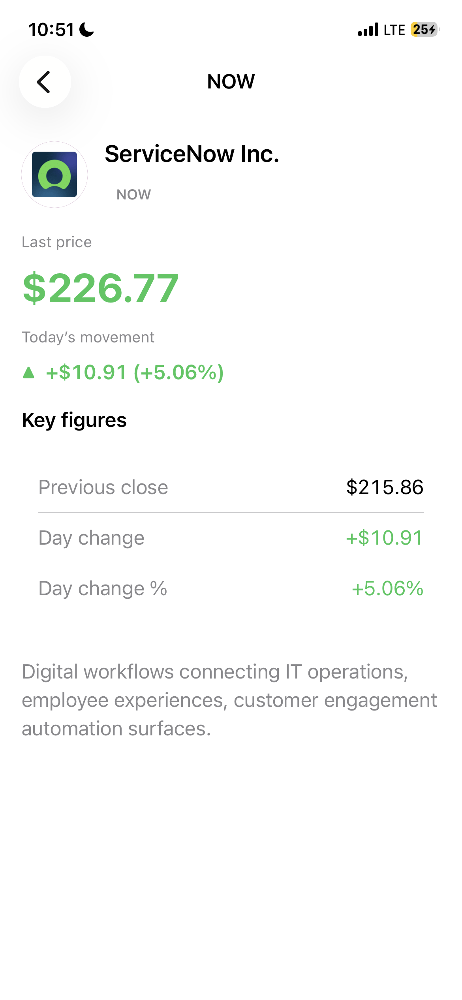
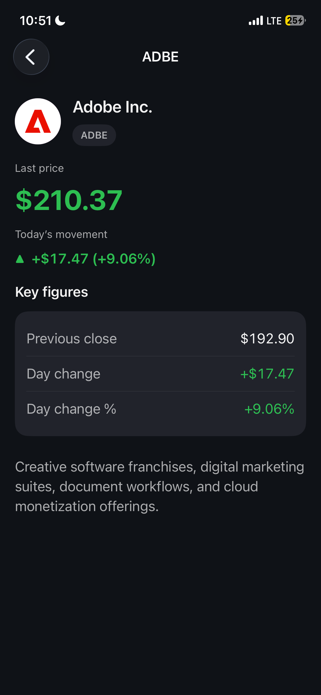
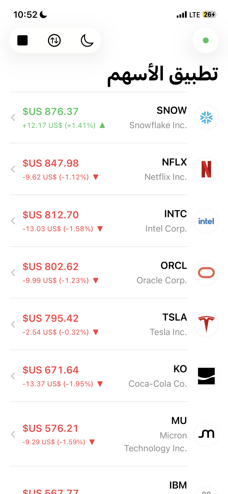
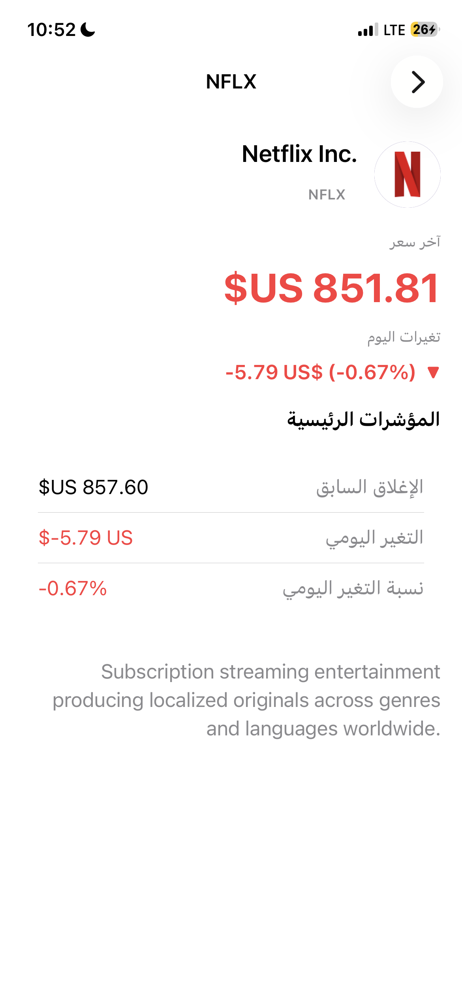
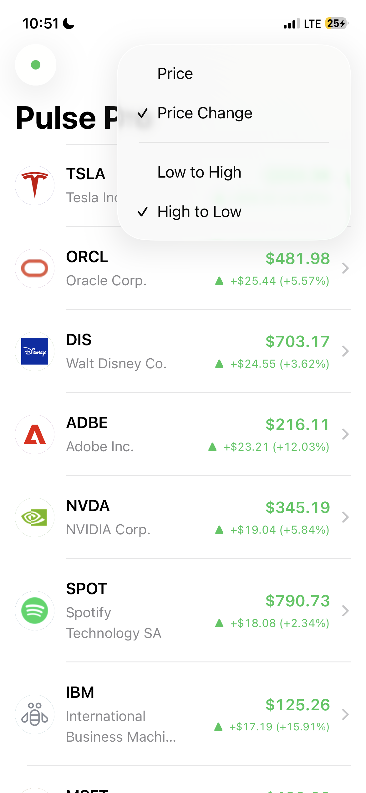
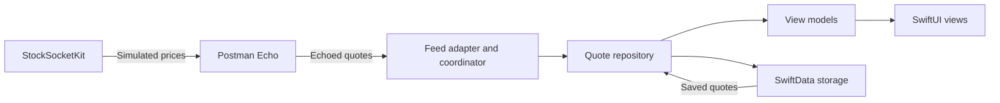

# Pulse Pro

<div align="center">


An iOS app for streaming simulated stock quotes over WebSocket, with local persistence and a local transport package.

[Features](#-about) • [Architecture](#️-architecture) • [Getting Started](#-getting-started) • [Testing](#-testing) • [CI](#-ci) • [Future Improvements](#-future-improvements)

</div>

---

## 📱 About

Pulse Pro generates a synthetic snapshot for all 25 symbols, sends it to Postman Echo, and displays the echoed JSON response. Postman echoes client-generated data; it does not supply market prices. Symbols and company blurbs ship in the bundled catalog resource; live updates merge into the UI and flush to Swift Data when appropriate. The feed starts on launch, so the list is live immediately. Browse a sortable roster, drill into detail, toggle light or dark presentation, stop or restart streaming, and recover gracefully when connectivity returns using Network reachability to resume the feed.

The default feed uses `wss://ws.postman-echo.com/raw`.

### Key Features

- Catalog-backed symbol list (bundled JSON: symbol, display name, description)
- Live simulated quotes streamed through Postman Echo
- Persisted snapshots and a paging API for reading stored quotes
- Connection state surfaced in the UI across idle, connecting, connected, and failure paths
- Streaming pauses when the app is inactive
- Stock details, sorting, and light and dark appearance
- Automatic connection recovery that respects the Stop action

---

## 🎬 Screenshots

<div align="center">









</div>

### Demo Video
https://github.com/user-attachments/assets/78733d7f-96b5-4ab9-a402-b4bbb20b6d18


---

## 🏗️ Architecture

- **Presentation:** SwiftUI views and observable view models.
- **Domain:** Stock models, protocols, and use cases.
- **Data:** Quote validation, shared data, and SwiftData persistence.
- **Infrastructure:** Network monitoring and logging.
- **Composition:** Creates and connects dependencies.
- **StockSocketKit:** Local package for simulated prices, WebSocket connections, retries, and health checks.
- **Data flow:** Generated prices → Postman Echo → repository → UI and local storage.



---

## 🛠️ Tech Stack

| Area | Choices |
|------|---------|
| UI | SwiftUI, NavigationStack, Observation |
| Persistence | Swift Data with a PersistedQuote schema |
| Concurrency | async and await, actors in the socket package, MainActor repository |
| Networking | URLSessionWebSocketTask with a custom handshake coordinator |
| Structure | Domain folder in the app; StockSocketKit as the local transport package |
| Quality | SwiftLint in strict CI, XCTest per module plus an app UITest target |

Development notes:

- Swift 6.2+
- iOS 18+
- Xcode 27

---

## 📁 Project Structure

```text
LiveStockTracker/
├── LiveStockTracker/
│   ├── LiveStockTrackerApp.swift
│   ├── Composition/              # Dependency setup and feed configuration
│   ├── Domain/                   # Entities, protocols, and use cases
│   ├── Config/                   # Build configuration
│   ├── Data/
│   │   ├── Repository/           # Shared quotes and persistence coordination
│   │   ├── Feed/                 # Feed adapter, session lifecycle, and quote mapping
│   │   ├── Persistence/          # SwiftData storage and batched saves
│   │   ├── Catalog/              # Catalog JSON decoding
│   │   ├── EventBroadcast/       # Event distribution
│   │   └── Formatting/           # Numeric encoding helpers
│   ├── Presentation/
│   │   ├── Views/
│   │   ├── ViewModels/
│   │   └── Support/              # Palettes, navigation, and formatting
│   ├── Infrastructure/           # Network monitoring and logging
│   ├── Testing/                  # Debug-only UI test environment
│   ├── Assets.xcassets/
│   ├── Localizable.xcstrings
│   ├── PrivacyInfo.xcprivacy
│   └── Resources/
│       ├── catalog.json
│       └── FeedTransportTuning.json
├── LiveStockTrackerTests/
├── LiveStockTrackerUITests/
├── StockSocketKit/               # Local WebSocket transport package
├── Docs/                         # README screenshots
├── LiveStockTracker.xcodeproj/
├── Package.swift                 # Host-side app logic tests
├── README.md
├── .gitignore
├── .swiftlint.yml
└── .github/
    └── workflows/
        └── ci.yml
```

---

## 🚀 Getting Started

### Requirements

- Xcode 27
- iOS 18 or later
- macOS for simulator or device builds

### Running

1. Clone the repository and open `LiveStockTracker.xcodeproj` in Xcode 27.
2. Select the `LiveStockTracker` scheme and an iPhone simulator.
3. Run the app. The simulated feed starts automatically.

An internet connection is required for streaming. Previously saved quotes remain available offline.

---

## 🧪 Testing

Tests cover sorting, feed lifecycle, connection recovery, persistence, view models, and localization.

Run app logic tests:

```bash
swift test
```

Run socket package tests:

```bash
swift test --package-path StockSocketKit
```

Run iOS unit and UI tests from Xcode using **Product → Test**.

The live echo test is optional and contacts Postman:

```bash
STOCKSOCKET_LIVE_TESTS=1 swift test --package-path StockSocketKit --filter LiveEchoSmokeTests
```

CI runs lint, host tests, Thread Sanitizer, and iOS build checks. UI tests run locally.

---

## 🔄 CI

Workflow: .github/workflows/ci.yml

| Job | Purpose |
|-----|---------|
| host | Strict lint, app logic tests with a coverage report, socket package tests, and both suites under Thread Sanitizer |
| ios | Builds the app and its test bundles (UI tests run locally), and a Release build that must not contain the UI-testing environment |

Workflow triggers on push and pull_request to the repository.

### Transport configuration

Transport timings and retry settings use defaults from StockSocketKit. The bundled `LiveStockTracker/Resources/FeedTransportTuning.json` can override them. Missing or invalid configuration falls back to defaults, and values are clamped to supported ranges. Remote configuration is not currently connected.

| Key | Default | Meaning |
|-----|---------|---------|
| `outboundIntervalMilliseconds` | 1000 | Time between snapshots the client sends |
| `handshakeTimeoutMilliseconds` | 30000 | Give up on a connection attempt |
| `heartbeatIntervalMilliseconds` | 15000 | WebSocket ping cadence |
| `pongTimeoutMilliseconds` | 5000 | Ping reply deadline |
| `sendTimeoutMilliseconds` | 10000 | Send deadline |
| `staleDataTimeoutMilliseconds` | 10000 | Replace a link that delivers no decodable frame for this long |
| `maxConsecutiveDecodeFailures` | 5 | Bad frames in a row before the feed ends |
| `backoffInitialMilliseconds` / `backoffMultiplier` / `backoffMaxMilliseconds` | 250 / 1.75 / 8000 | Reconnect backoff (full jitter) |

### Batch events

One feed frame is one snapshot of all 25 symbols. The kit emits it as a single
`WebSocketPublicEvent.decodedBatch([EchoStockPayload])`, the repository publishes it as a single `QuoteBatch`
through `StockRepositoryProtocol.quoteBatches()`, and each screen refreshes once per batch. The detail screen
ignores batches that do not contain its symbol, and a batch where nothing is usable or new publishes nothing.

### Currency and regions

Quote currency is the instrument's currency, not the user's. These are US equities, so prices are always shown in USD, whatever the device region; only the formatting (digits, separators, symbol placement, percent style, RTL layout) follows the user's locale. Converting to a local currency would need an FX source and would silently change what a price means.

### Sorting

The sort menu has two independent choices: the field (Price, Price Change) and the direction (Low to High,
High to Low), giving four orderings. Equal values fall back to the symbol A to Z, so the order is total and rows
never swap places only because two prices tied. Symbols that have no price yet always trail A to Z.

### Persistence

SwiftData reads and writes are serialized through the persistence actor. Failed saves are retried without interrupting live prices, and the list shows a banner until saving succeeds.

### Test-only code

Debug builds launched with `--ui-testing` use deterministic quotes and an in-memory store. Release builds exclude this testing environment. Unit-test fakes stay in the test targets.

### Connection handling

The feed checks connection health and retries temporary failures. It reconnects when the network changes, while a feed you stop stays stopped.

---

## 📦 Domain and Local Package

The domain contains entities, protocols, and use cases, with Foundation as its only framework dependency. StockSocketKit handles transport independently of the app.

A different backend can be added through the `PriceFeed` protocol. It would need its own authentication, subscription, and decoding logic.

---

## 🔮 Future Improvements

- Add certificate pinning through `EchoTLSHooks` once the app talks to its own backend.
- Document the production WebSocket JSON contract alongside the echo format so backend swaps stay predictable.
- Add explicit user-facing reconnection or status copy when the feed is paused by policy versus network loss.
- Optional widget or Live Activity for a small subset of watched symbols.
- Structured analytics or crash reporting hooks for release builds, wired behind compile flags.
- Richer charting or historical series if the backend gains time-bucketed data beyond point-in-time quotes.
- Professional review of Arabic translations and localized company descriptions. Interface strings currently support English and Arabic; bundled company descriptions remain English. USD is the quote denomination, while number and percentage presentation follows the user's locale.

---

## 👤 Author

**Muhammad Ali Maniar**

- GitHub: [@maniarali](https://github.com/maniarali)

---

## 🙏 Acknowledgments

- [Postman Echo WebSocket sandbox](https://learning.postman.com/docs/sending-requests/websocket/create-a-websocket-request/) for default and demo connectivity at wss://ws.postman-echo.com/raw.
- Apple frameworks: SwiftUI, Swift Data, Network, URLSession.

---

<div align="center">

Swift 6 • Swift Packages • Streams and persistence

[⬆ Back to Top](#pulse-pro)

</div>
